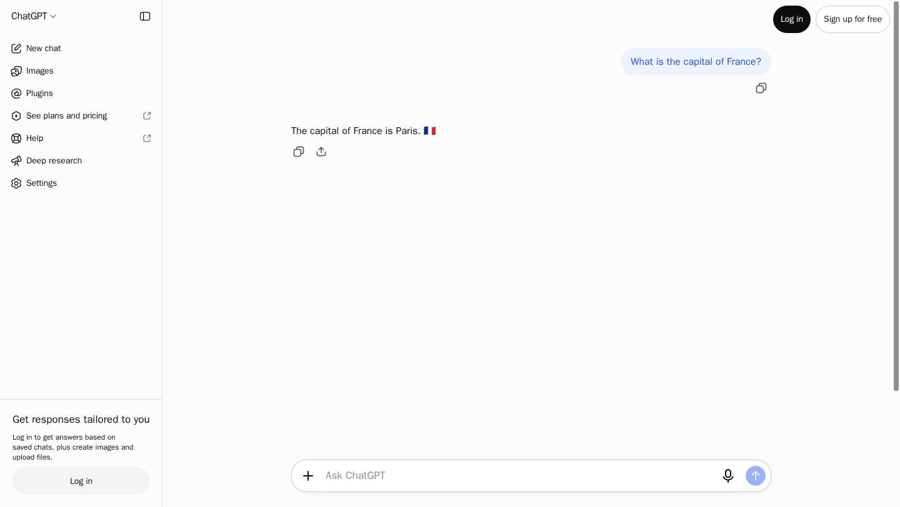

# AdsCrawl Scrapers

由 AdsCrawl 维护的 Python 爬虫示例集，使用 [AdsCrawl Python SDK](https://github.com/AdsCrawl/adscrawl-python)，覆盖 81 个站点。
包含商品、搜索、评论、房产、航班等数据提取。完整目录见 [英文 README](README.md)。

## 安装与运行

需要 Python 3.10 或更新版本：

```bash
git clone https://github.com/AdsCrawl/adscrawl-scrapers.git
cd adscrawl-scrapers
python -m venv .venv
source .venv/bin/activate
python -m pip install -e ".[dev]"
export ADSCRAWL_API_KEY="你的 API Key"
export ADSCRAWL_DEFAULT_COUNTRY=US
cd amazon-scraper
python run.py
```

先修改 `run.py` 中的 URL、日期和页数。真实请求会消耗 AdsCrawl 额度。
默认每个客户端最多使用两个浏览器会话，可以通过 `ADSCRAWL_CONCURRENCY` 调整。
无需安装本地 Chromium；浏览器由 AdsCrawl 提供。

未指定国家或自定义代理时使用 **US 美国线路**。
`scripts/live_test.py` 在 `ADSCRAWL_DEFAULT_COUNTRY` 为空时设为 `US`，手动在线工作流也会设为 `US`。
自行设置该变量可改用其他线路。站点显式设置的 `countryCode` 优先。
自定义代理与国家路由不会同时发送。

## SDK 工作方式

- 通过官方 SDK 创建和关闭 CDP 会话，Playwright 负责导航、点击、滚动和 XHR 捕获。
- POST/JSON 请求也在远程浏览器中执行；命名会话在同一次站点操作中保留 Cookie 和浏览器状态。
- 每个站点包含独立的分页、解析逻辑和运行示例。
- Air France 使用同步 SDK；Google AI Mode 改为 AdsCrawl DOM 字段提取，可通过环境变量调整选择器。
- 所有新提交使用 `AdsCrawl <support@adscrawl.net>`。

## 验证状态

> 2026-11-03（Asia/Shanghai）用 PR #1 的验收脚本复测，默认美国线路，每轮不重试（`--reruns=0`），并发为 1。离线测试 47/47、目录检查 81/81 通过。在线烟雾测试通过（渲染后的 HTML、JSON POST、会话清理）。在线套件通过的是 **bing**（第二次 2/2，走代码里写死的英国线路）和 **shopify**（5/5）。**chatgpt** 两轮都未通过（0/1，超时或空回答）。其余站点本轮没有重测。上一次全站审计仍是 [2026-10-27 报告](docs/live-verification/2026-10-27.md)（15 个整套通过、11 个部分通过、55 个未通过）。这些结果只说明当天目标网站的表现。

`scripts/live_test.py` 在 `ADSCRAWL_DEFAULT_COUNTRY` 为空时设为 `US`。站点自己的 `countryCode` 会覆盖该默认值。Bing 的 `BASE_CONFIG` 写死 `countryCode` 为 `GB`，所以两次 Bing 都走英国线路，而不是这次的美国默认值。第一次 Bing 为 1 通过 / 1 失败（分页导航错误），第二次为 2/2。

| 本次复测（2026-11-03） | 结果 |
| --- | --- |
| `scripts/smoke.py` | 通过，退出码 0：渲染 HTML、JSON POST、会话清理 |
| [bing](bing-scraper/) | 第二次 2/2，内置英国线路。第一次 1/2，分页导航错误 |
| [shopify](shopify-scraper/) | 5/5 通过 |
| [chatgpt](chatgpt-scraper/) | 两轮都是 0/1：超时或空回答。未通过 |

本次设置：`ADSCRAWL_DEFAULT_COUNTRY=US`，`ADSCRAWL_CONCURRENCY=1`，`--reruns=0`。
`results/` 是历史示例，不是这次复测的输出。
下面的截图来自 2026-10-27 审计。ChatGPT 在 2026-11-03 没有通过。



<!-- LIVE_VERIFIED_START -->

2026-10-27 整套通过的站点（2026-11-03 未重跑）：

| 爬虫 | 通过的实测用例 |
| --- | --- |
| [app-store](app-store-scraper/) | 2/2 |
| [bing](bing-scraper/) | 2/2 |
| [chatgpt](chatgpt-scraper/) | 1/1 |
| [fashionphile](fashionphile-scraper/) | 2/2 |
| [idealo](idealo-scraper/) | 4/4 |
| [imdb](imdb-scraper/) | 5/5 |
| [imovelweb](imovelweb-scraper/) | 2/2 |
| [reddit](reddit-scraper/) | 4/4 |
| [rightmove](rightmove-scraper/) | 2/2 |
| [shopify](shopify-scraper/) | 5/5 |
| [similarweb](similarweb-scraper/) | 4/4 |
| [ticketmaster](ticketmaster-scraper/) | 2/2 |
| [twitter](twitter-scraper/) | 2/2 |
| [vestiairecollective](vestiairecollective-scraper/) | 2/2 |
| [zillow](zillow-scraper/) | 2/2 |

[查看验证范围、输出数量和限制](docs/live-verification/2026-10-27.md)

<!-- LIVE_VERIFIED_END -->

默认 CI 只做离线验证。2026-11-03 的在线复测只覆盖烟雾测试、Bing、Shopify 和 ChatGPT，不是全站通过。
[初始验证记录](docs/VERIFICATION.md)和[2026-10-27 实测报告](docs/live-verification/2026-10-27.md)是更早的全站审计。

```bash
python -m pytest tests -q
python scripts/check_catalog.py
# 以下命令会使用额度。未设置国家时 live_test 默认 US；站点自己的 countryCode 优先。
# Bing 写死 GB，因此不会改走 US。
export ADSCRAWL_API_KEY="你的 API Key"
export ADSCRAWL_DEFAULT_COUNTRY=US
export ADSCRAWL_CONCURRENCY=1
python scripts/smoke.py
SELECTED_SCRAPER=bing-scraper python scripts/live_test.py
SELECTED_SCRAPER=shopify-scraper python scripts/live_test.py
SELECTED_SCRAPER=chatgpt-scraper python scripts/live_test.py
```

---

采用 [OSL-3.0](LICENSE) 许可证，相关声明见 [NOTICE](NOTICE)。
