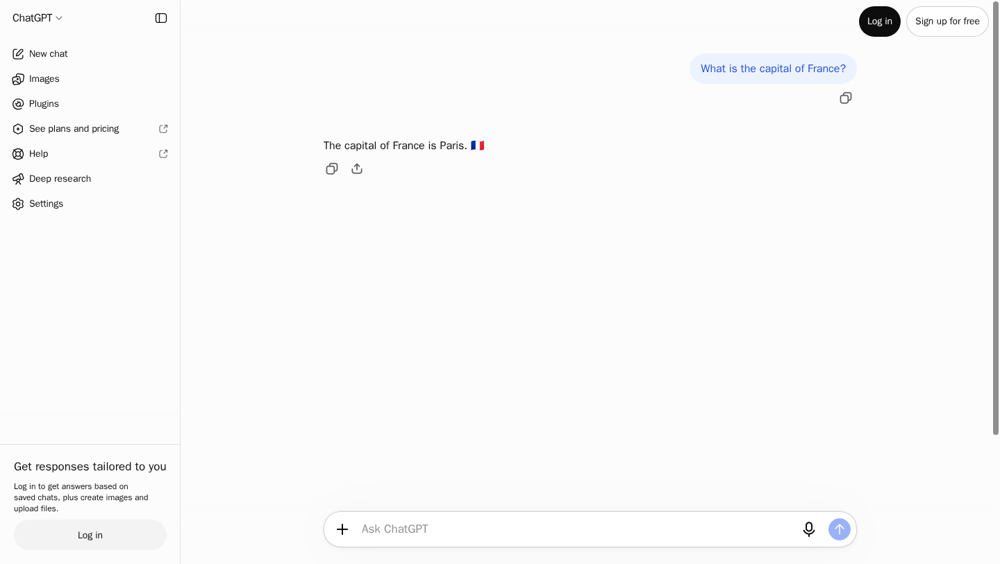
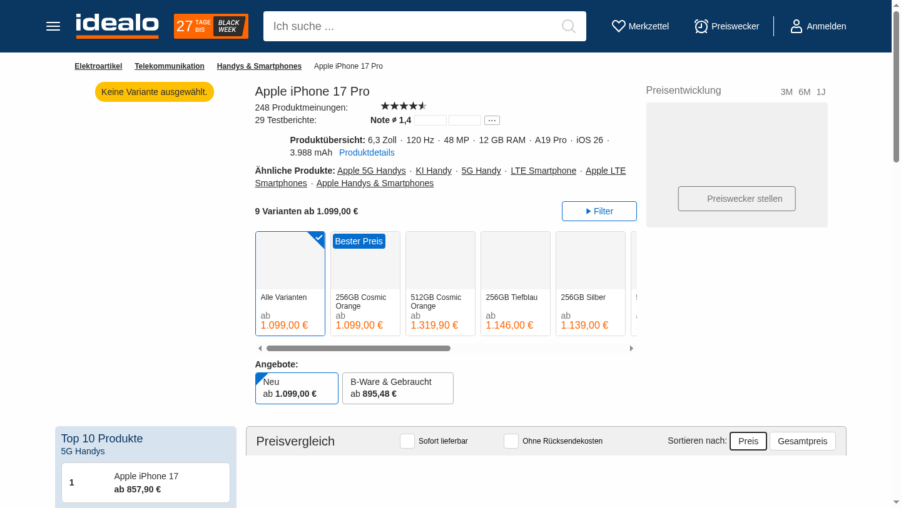

# 81 个爬虫真实验证报告

日期：2026-10-27（Asia/Shanghai）。状态：首轮完成。

当前：11 个整套现有测试通过，14 个部分通过，56 个未通过，0 个待测。

这些结果来自真实 AdsCrawl SDK 请求，不是历史 `results/` 样例或模拟测试。每站运行现有 `test.py`，遇到首个失败暂停该站剩余用例；每站限时 300 秒。首轮逐站运行；修复后复测分两组执行，每组最多一个浏览器会话。部分通过仅覆盖表中列出的功能，不代表整个站点可用。空结果不能证明抓取成功。

后续请求默认使用 US 美国线路；站点显式指定的地区优先。JSON 中的 countries 记录采集启用后实际创建的浏览器国家，早期未记录的请求保持空值。

代码修复在本轮进行中持续提交；早期失败记录保留到修复后完成复测。外部站点、数据、代理线路和访问限制会变化，本报告只证明该日期、该用例的观察结果。API Key、CDP URL、Cookie 和原始调试日志不公开。

## 已核验的输出与截图

- **Bing**：搜索 30 条结果，关键词建议 8 条；2 项现有测试通过。
- **Similarweb**：4 项测试通过；3 个站点分析、2 个站点比较、3 个趋势榜单和 907 个站点地图 URL。
- **Shopify**：5 项测试通过；40 个目录商品、20 个集合商品、2 个商品详情和 357 个商品 URL。
- **Imovelweb**：搜索返回 30 个房源，另验证 3 个房源详情；2 项测试通过。
- **Idealo**：4 项测试通过；1 个商品详情、60 条搜索结果、36 个品牌商品和 92 个价格历史点。
- **ChatGPT**：真实提问“What is the capital of France?”，提取回答包含“Paris”；1 项现有测试通过，并检查了实际输出。






## 逐站状态

| 站点 | 状态 | 原测试通过 / 已收集 | 已观察到的输出 | 失败或限制 |
| --- | --- | --- | --- | --- |
| [airbnb](../../airbnb-scraper/) | ❌ 未通过 | 0/2 | — | ERR_TUNNEL_CONNECTION_FAILED |
| [airfrance](../../airfrance-scraper/) | ❌ 未通过 | 0/1 | — | US 线路下页面显示无法连接 reCAPTCHA 服务；未返回航班结果。；RuntimeError |
| [aliexpress](../../aliexpress-scraper/) | 🟡 部分通过 | 1/4 | — | SCRAPE_FAILED |
| [allegro](../../allegro-scraper/) | ❌ 未通过 | 0/2 | — | SCRAPE_FAILED |
| [amazon](../../amazon-scraper/) | ❌ 未通过 | 0/3 | — | SCRAPE_FAILED；超过 300 秒限时 |
| [app-store](../../app-store-scraper/) | 🟡 部分通过 | 1/2 | scrape_app_metadata：37 个字段 | SCRAPE_FAILED |
| [autoscout24](../../autoscout24-scraper/) | 🟡 部分通过 | 1/3 | scrape_listings：20 条 | HTTP 403；目标导航 HTTP 403；首轮返回 20 条；后续请求失败，离线 URL 用例不算实测通过 |
| [bestbuy](../../bestbuy-scraper/) | ❌ 未通过 | 0/4 | — | SCRAPE_FAILED |
| [bing](../../bing-scraper/) | ✅ 通过 | 2/2 | scrape_search：30 条；scrape_keywords：8 条 | — |
| [bookingcom](../../bookingcom-scraper/) | ❌ 未通过 | 0/3 | — | SCRAPE_FAILED |
| [capterra](../../capterra-scraper/) | 🟡 部分通过 | 1/2 | scrape_category：2 个字段 | HTTP 403；目标导航 HTTP 403 |
| [chatgpt](../../chatgpt-scraper/) | ✅ 通过 | 1/1 | scrape_conversation：151 字符 | — |
| [crunchbase](../../crunchbase-scraper/) | ❌ 未通过 | 0/2 | — | UnboundLocalError；目标导航 HTTP 403 |
| [dhl](../../dhl-scraper/) | ❌ 空结果，未通过 | 1/1 | scrape_tracking：0 个字段 | 示例运单没有返回轨迹；已加强测试，空数据不计为通过。；目标导航 HTTP 403；测试返回空输出，验收不通过 |
| [digikey](../../digikey-scraper/) | ❌ 未通过 | 0/3 | — | HTTP 403；目标导航 HTTP 403 |
| [domaincom](../../domaincom-scraper/) | ❌ 未通过 | 0/2 | — | ValueError；超过 300 秒限时 |
| [ebay](../../ebay-scraper/) | ❌ 未通过 | 0/3 | — | HTTP 403；目标导航 HTTP 403 |
| [emirates](../../emirates-scraper/) | ❌ 未通过 | 0/1 | — | SCRAPE_FAILED |
| [etsy](../../etsy-scraper/) | ❌ 未通过 | 0/3 | — | HTTP 403；目标导航 HTTP 403 |
| [expedia](../../expedia-scraper/) | ❌ 未通过 | 0/2 | — | TypeError |
| [facebook](../../facebook-scraper/) | 🟡 部分通过 | 2/4 | scrape_facebook_page：3 条；scrape_marketplace_listings：12 条 | SCRAPE_FAILED |
| [fashionphile](../../fashionphile-scraper/) | 🟡 部分通过 | 1/2 | scrape_products：3 条 | SCRAPE_FAILED |
| [g2](../../g2-scraper/) | ❌ 未通过 | 0/3 | — | TIMEOUT；目标导航 HTTP 403 |
| [glassdoor](../../glassdoor-scraper/) | 🟡 部分通过 | 3/6 | find_companies：10 条 | HTTP 403；目标导航 HTTP 403 |
| [goat](../../goat-scraper/) | ❌ 未通过 | 0/2 | scrape_search：12 条 | ERR_TUNNEL_CONNECTION_FAILED |
| [goibibo](../../goibibo-scraper/) | ❌ 未通过 | 0/2 | — | 首屏捕获到酒店 JSON；分页接口返回 HTTP 200 的非 JSON 文本，整套用例未通过。；JSONDecodeError |
| [goodreads](../../goodreads-scraper/) | 🟡 部分通过 | 1/4 | scrape_book：13 个字段 | ERR_TUNNEL_CONNECTION_FAILED |
| [google-flights](../../google-flights-scraper/) | ❌ 未通过 | 0/2 | scrape_flights：5 个字段 | 页面显示 No results returned / Oops, something went wrong；未获得航班记录。；AssertionError |
| [google-jobs](../../google-jobs-scraper/) | ❌ 未通过 | 0/1 | scrape_jobs：4 个字段 | AssertionError |
| [google-play](../../google-play-scraper/) | ❌ 未通过 | 0/3 | — | ERR_TUNNEL_CONNECTION_FAILED |
| [google](../../google-scraper/) | ❌ 未通过 | 0/5 | — | HTTP 429；目标导航 HTTP 429 |
| [homegate](../../homegate-scraper/) | ❌ 未通过 | 0/2 | — | HTTP 403；目标导航 HTTP 403 |
| [idealista](../../idealista-scraper/) | ❌ 未通过 | 0/3 | — | HTTP 403；目标导航 HTTP 403 |
| [idealo](../../idealo-scraper/) | ✅ 通过 | 4/4 | scrape_products：1 条；scrape_search：60 条；scrape_manufacturer：5 个字段；scrape_price_history：10 个字段 | — |
| [imdb](../../imdb-scraper/) | ❌ 未通过 | 0/5 | scrape_titles：0 条 | 返回 HTTP 202 验证页面；首轮未获得影片结构化数据，等待数据就绪的修复待复测。；AssertionError；未返回可验收的数据 |
| [immobilienscout24](../../immobilienscout24-scraper/) | ❌ 未通过 | 0/2 | — | HTTP 401；目标导航 HTTP 401 |
| [immoscout24](../../immoscout24-scraper/) | ❌ 未通过 | 0/2 | — | HTTP 403；目标导航 HTTP 403 |
| [immowelt](../../immowelt-scraper/) | ❌ 未通过 | 0/2 | — | HTTP 403；目标导航 HTTP 403 |
| [imovelweb](../../imovelweb-scraper/) | ✅ 通过 | 2/2 | scrape_search：3 个字段；scrape_search：3 个字段；scrape_properties：3 条 | — |
| [indeed](../../indeed-scraper/) | ❌ 未通过 | 0/2 | — | HTTP 403；目标导航 HTTP 403 |
| [instagram](../../instagram-scraper/) | 🟡 部分通过 | 2/4 | scrape_user：16 个字段；scrape_post：10 个字段 | HTTP 401；目标导航 HTTP 401 |
| [kayak](../../kayak-scraper/) | ❌ 未通过 | 0/1 | — | TIMEOUT |
| [leboncoin](../../leboncoin-scraper/) | ❌ 未通过 | 0/2 | — | HTTP 403；目标导航 HTTP 403 |
| [linkedin](../../linkedin-scraper/) | 🟡 部分通过 | 1/5 | scrape_profile：1 条 | ERR_TUNNEL_CONNECTION_FAILED |
| [loopnet](../../loopnet-scraper/) | ❌ 未通过 | 0/2 | — | HTTP 403；目标导航 HTTP 403 |
| [lowes](../../lowes-scraper/) | ❌ 未通过 | 0/3 | — | HTTP 403；目标导航 HTTP 403 |
| [maersk](../../maersk-scraper/) | ❌ 未通过 | 0/2 | — | HTTP 403 |
| [marriott](../../marriott-scraper/) | ❌ 未通过 | 0/2 | — | HTTP 403；目标导航 HTTP 403 |
| [mouser](../../mouser-scraper/) | ❌ 未通过 | 0/2 | — | HTTP 403；目标导航 HTTP 403 |
| [naver](../../naver-scraper/) | ❌ 未通过 | 0/4 | — | ERR_CERT_AUTHORITY_INVALID |
| [nordstorm](../../nordstorm-scraper/) | ❌ 未通过 | 0/2 | — | 返回的文档没有商品配置数据；已增加数据就绪检查，待复测。；AttributeError |
| [perplexity](../../perplexity-scraper/) | ❌ 未通过 | 0/1 | — | ERR_TUNNEL_CONNECTION_FAILED |
| [pinterest](../../pinterest-scraper/) | 🟡 部分通过 | 2/5 | scrape_search：3 个字段；scrape_board：8 个字段 | BROWSER_ERROR |
| [realestatecom](../../realestatecom-scraper/) | ❌ 未通过 | 0/2 | — | HTTP 429；目标导航 HTTP 429 |
| [realtorcom](../../realtorcom-scraper/) | ❌ 未通过 | 0/3 | — | HTTP 429；目标导航 HTTP 429 |
| [reddit](../../reddit-scraper/) | 🟡 部分通过 | 2/4 | scrape_subreddit：2 个字段；scrape_post：2 个字段 | TypeError |
| [redfin](../../redfin-scraper/) | ❌ 未通过 | 0/3 | — | ValueError |
| [rightmove](../../rightmove-scraper/) | ✅ 通过 | 2/2 | find_locations：10 条；scrape_search：75 条；find_locations：10 条；scrape_search：50 条；scrape_properties：5 条 | — |
| [rs-online](../../rs-online-scraper/) | ❌ 未通过 | 0/3 | — | HTTP 403；目标导航 HTTP 403 |
| [seloger](../../seloger-scraper/) | ❌ 未通过 | 0/2 | — | HTTP 403；目标导航 HTTP 403 |
| [shopify](../../shopify-scraper/) | ✅ 通过 | 5/5 | scrape_catalog：40 条；scrape_collection：20 条；scrape_product_pages：2 条；scrape_product_urls：357 条 | — |
| [similarweb](../../similarweb-scraper/) | ✅ 通过 | 4/4 | scrape_website：3 条；scrape_website_compare：2 个字段；scrape_trendings：3 条；scrape_sitemaps：907 条 | — |
| [skyscanner](../../skyscanner-scraper/) | ❌ 未通过 | 0/1 | — | TIMEOUT |
| [stockx](../../stockx-scraper/) | ❌ 未通过 | 0/2 | — | HTTP 403；目标导航 HTTP 403 |
| [target](../../target-scraper/) | ❌ 未通过 | 0/5 | — | 商品页面可打开，但 deferred_enrichment 数据接口返回 HTTP 435。；ValueError |
| [threads](../../threads-scraper/) | ❌ 未通过 | 0/2 | — | ERR_TUNNEL_CONNECTION_FAILED；超过 300 秒限时 |
| [ticketmaster](../../ticketmaster-scraper/) | ✅ 通过 | 2/2 | scrape_artist：2 条；scrape_discovery：3 个字段 | — |
| [tiktok](../../tiktok-scraper/) | ❌ 未通过 | 0/5 | — | TIMEOUT |
| [tripadvisor](../../tripadvisor-scraper/) | ❌ 未通过 | 0/3 | — | HTTP 403；目标导航 HTTP 403 |
| [trustpilot](../../trustpilot-scraper/) | ❌ 未通过 | 0/3 | — | HTTP 403；目标导航 HTTP 403 |
| [twitter](../../twitter-scraper/) | ✅ 通过 | 2/2 | scrape_tweet：16 个字段；scrape_profile：16 个字段 | — |
| [vestiairecollective](../../vestiairecollective-scraper/) | ✅ 通过 | 2/2 | scrape_search：180 条；scrape_products：3 条；scrape_search：180 条 | — |
| [walmart](../../walmart-scraper/) | ❌ 未通过 | 0/2 | — | ERR_CONNECTION_CLOSED |
| [wellfound](../../wellfound-scraper/) | ❌ 未通过 | 0/2 | — | HTTP 403；目标导航 HTTP 403 |
| [yellowpages](../../yellowpages-scraper/) | 🟡 部分通过 | 1/2 | scrape_pages：3 条 | HTTP 403；目标导航 HTTP 403 |
| [yelp](../../yelp-scraper/) | ❌ 未通过 | 0/3 | — | ERR_TUNNEL_CONNECTION_FAILED |
| [youtube](../../youtube-scraper/) | ❌ 未通过 | 0/7 | — | 目标要求登录以确认并非机器人，未取得可验证的视频数据。；Exception |
| [zillow](../../zillow-scraper/) | ✅ 通过 | 2/2 | scrape_search：123 条；scrape_properties：1 条 | — |
| [zoominfo](../../zoominfo-scraper/) | ❌ 未通过 | 0/3 | — | HTTP 403；目标导航 HTTP 403 |
| [zoopla](../../zoopla-scraper/) | 🟡 部分通过 | 1/2 | scrape_search：58 条；scrape_properties：3 条 | Failed |
| [zoro](../../zoro-scraper/) | ❌ 未通过 | 0/2 | — | HTTP 403；目标导航 HTTP 403 |

## 复现

```bash
python -m pip install -e ".[dev]"
export ADSCRAWL_API_KEY="your_api_key"
python -m pytest bing-scraper/test.py -x -q --reruns=0
```

每个站点的具体测试名称、耗时和输出数量见 [JSON 记录](2026-10-27.json)。真正抓取会消耗账户额度；默认 CI 仍只做离线验证。
